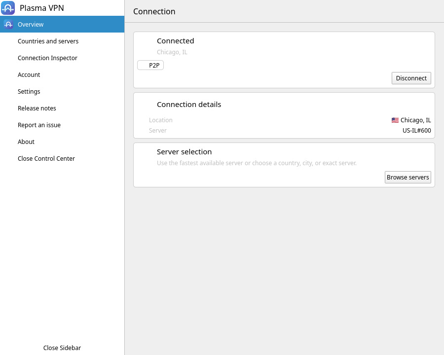
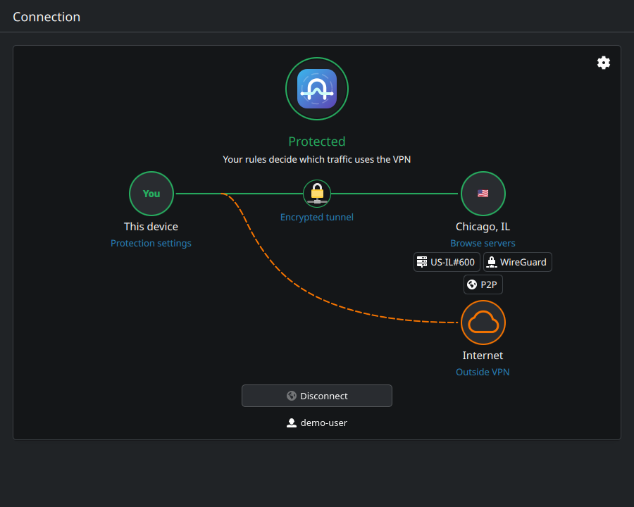
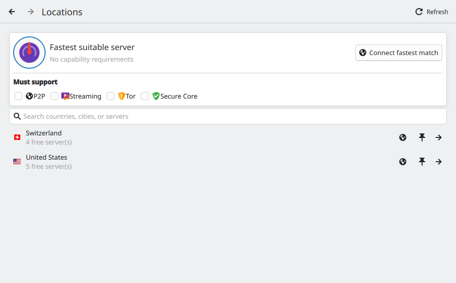
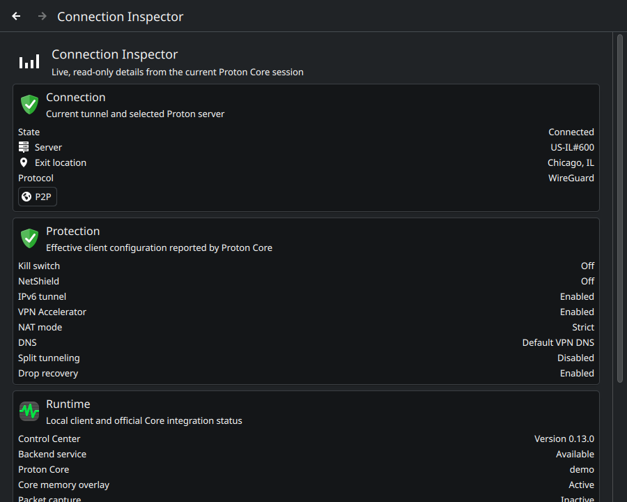
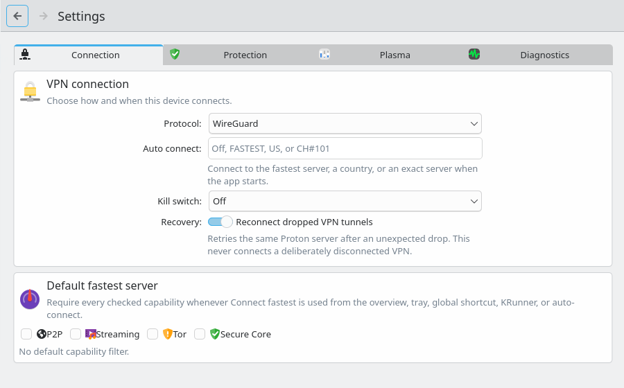

<p align="center">
  
</p>

<h1 align="center">Plasma VPN</h1>

<p align="center">
  <strong>A native KDE Plasma client for Proton VPN, built around Proton's official Linux VPN Core.</strong>
</p>

<p align="center">
  <a href="https://github.com/uglyegg/proton-vpn-kde/actions/workflows/ci.yml"></a>
  <a href="https://github.com/uglyegg/proton-vpn-kde/actions/workflows/rpm.yml"></a>
  <a href="https://github.com/uglyegg/proton-vpn-kde/actions/workflows/deb.yml"></a>
  <a href="LICENSE"></a>
  <a href="docs/COMPATIBILITY.md"></a>
  <a href="docs/COMPATIBILITY.md"></a>
  <a href="docs/VISUAL-SYSTEM.md"></a>
  
</p>

> [!IMPORTANT]
> Plasma VPN is independent community software, not developed, reviewed, sponsored, or endorsed by Proton AG. “Proton” and “Proton VPN” identify compatibility; their names and marks remain Proton's own.

Plasma VPN gives Proton's Linux networking stack a KDE home: a Kirigami Control Center, a lean resident agent, native notifications, KRunner actions, global shortcuts, and System Settings integration. It follows your Plasma theme and keeps the full interface on demand.

The interface is C++20, Qt 6, KDE Frameworks 6, and Kirigami—not GTK. Proton Core still owns VPN protocols, NetworkManager, protection, split tunneling, and account sessions. Its upstream packages retain a GNOME NetworkManager OpenVPN editor dependency; Plasma VPN neither uses that editor nor removes the dependency.

## See it

| Connected | Split tunneling |
| :---: | :---: |
| [](docs/images/overview.png) | [](docs/images/overview-split.png) |

| Server browser | Connection Inspector | Native settings |
| :---: | :---: | :---: |
| [](docs/images/locations.png) | [](docs/images/inspector.png) | [](docs/images/settings.png) |

Light and dark Plasma themes, captured with the deterministic demo backend. These are simulated connections, with no account or real VPN tunnel.

## Why this exists

The project was started by a paying Proton subscriber since 2017 who wanted the KDE experience to reflect the quality of the service. The aim is a credible Plasma client that preserves Proton's networking ownership and keeps its community integration straightforward to review.

## What it offers

- Native sign-in, authenticator and recovery codes, and saved sessions through Freedesktop Secret Service, including the verified KeePassXC stack.
- Country, state/city, Secure Core, and exact-server browsing; combinable P2P, Streaming, Tor, and Secure Core filters; saved Fastest defaults and pinned tray targets.
- Core-backed protocol, NetShield, NAT, port forwarding, IPv6, custom DNS, kill-switch, and split-tunneling controls.
- Opt-in login launch, window or tray-only startup, auto-connect, shortcuts, and confirmation-gated KRunner actions.
- A read-only Connection Inspector, connection-time exit addresses, local setup checks, and previewable community diagnostics.
- No automatic community diagnostic uploads. Direct Proton support submission, crash reporting, and optional connection telemetry are disabled in community builds; required Proton service traffic is unchanged.

See [Feature parity](docs/PARITY.md) for capability coverage and conditional features.

## Try it

Download the Fedora RPM or Ubuntu Debian package sets from [Releases](https://github.com/UglyEgg/proton-vpn-kde/releases/latest). Install the client and both required overlays together; the client package does not replace Proton-owned Python files outside package ownership.

[Compatibility](docs/COMPATIBILITY.md) lists exact versions, dependencies, and validation tiers. Fedora 44 is live-accepted; Ubuntu 26.04 amd64 with Plasma 6 is package-validated and still needs community field testing. Do not run the official and community frontends concurrently against the same Proton session.

## Engineering posture

Version 0.14.5 is the current public release. The project is public alpha. CI checks source, native and Python tests, static analysis, sanitizers, and Fedora/Ubuntu packaging. Release validation adds isolated review, reproducibility, signed artifacts, and installed acceptance.

The [assessment](docs/SECURITY-AUDIT-2026-08-30.md) records validation scope and assurance limits. [Performance](docs/PERFORMANCE.md) records measured results rather than a fixed memory promise. Neither constitutes independent third-party security certification.

The community adapter uses Core's public API and separately packaged, version-pinned overlays. See [Architecture](docs/ARCHITECTURE.md) for ownership and [Security policy](SECURITY.md) for the threat boundary and private reporting.

## Evaluate or contribute

Build and run the isolated, offscreen demo smoke without an account or network changes:

```bash
cmake -S . -B build -G Ninja -DBUILD_TESTING=ON
cmake --build build

dbus-run-session -- scripts/smoke-demo.sh
```

[Contributing](CONTRIBUTING.md) owns development checks and documentation conventions. Package instructions are in [Fedora packaging](packaging/fedora/README.md) and [Release procedure](docs/RELEASING.md).

| Question | Reference |
| --- | --- |
| What works, and on which stack? | [Compatibility](docs/COMPATIBILITY.md), [Feature parity](docs/PARITY.md) |
| How is it designed? | [Architecture](docs/ARCHITECTURE.md), [Visual system](docs/VISUAL-SYSTEM.md) |
| What is validated or still open? | [Assessment](docs/SECURITY-AUDIT-2026-08-30.md), [Roadmap](docs/ROADMAP.md) |
| Where should a problem be reported? | [Support](SUPPORT.md), [Security policy](SECURITY.md) |
| What changed? | [Changelog](CHANGELOG.md) |

Community code is licensed under `GPL-3.0-or-later`; see [LICENSE](LICENSE), [Copying](COPYING.md), and [Third-party notices](THIRD_PARTY_NOTICES.md). Original neutral artwork does not imply Proton affiliation or trademark permission.
